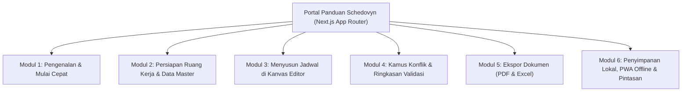

# Product Requirements Document (PRD): Schedovyn User Guide & Documentation Portal

| Informasi Dokumen | Detail |
|---|---|
| **Nama Proyek** | Schedovyn User Guide (Portal Panduan Pemakaian & Dokumentasi Resmi) |
| **Produk Induk** | Schedovyn (*Smart Timetable Planner*) |
| **Versi Dokumen** | 1.1.0 |
| **Status** | Siap Untuk Perancangan & Eksekusi Proyek Mandiri |
| **Framework Utama** | **Next.js** (App Router, React Server Components, MDX Content & Static Pre-rendering) |
| **Target Audiens** | Staf Kurikulum, Operator Sekolah, Wakil Kepala Sekolah Bidang Kurikulum, dan Guru Penyusun Jadwal |
| **Bahasa Antarmuka** | Bahasa Indonesia (Bebas karakter *em dash*) |
| **Gaya Desain Acuan** | `radix-lyra` (Architectural Technical Grid, `rounded-none`, Presisi Garis `1px`, Indigo-Blue `#1547E6`, `tabular-nums`) |

---

## 1. Ringkasan Eksekutif & Tujuan Produk

### 1.1 Latar Belakang
Meskipun antarmuka **Schedovyn** telah dirancang agar intuitif tanpa dokumentasi rumit, penyusunan jadwal sekolah secara inheren melibatkan banyak aturan bisnis akademik: pengaturan jam belajar per hari yang berbeda (seperti hari Jumat), pembatasan jam hadir guru (*unavailable intervals*), pengelolaan ruang praktik khusus, pembedaan antara **Konflik Waktu** dan **Peringatan Kelengkapan**, hingga strategi penyalinan jadwal antar-kelas paralel.

Pengguna di sekolah membutuhkan sebuah **Portal Panduan Pemakaian (User Guide)** yang terstruktur, mudah dicari, dilengkapi contoh studi kasus sekolah nyata, serta dapat dibaca dengan nyaman sambil membuka editor jadwal.

### 1.2 Tujuan Proyek User Guide
Membangun aplikasi web **Portal Panduan Pemakaian Schedovyn** mandiri berbasis **Next.js** yang bertujuan untuk:
1. Memandu pengguna baru menyusun jadwal sekolah pertama mereka dalam waktu **kurang dari 15 menit** (*Quick Start Guide*).
2. Menyediakan referensi lengkap langkah-demi-langkah untuk seluruh fitur aplikasi (`FR-01` s.d. `FR-12` dan `PWA-01`) menggunakan istilah antarmuka yang 100% akurat sesuai kode aplikasi produksi.
3. Menyediakan **Kamus Konflik & Cara Penyelesaiannya** agar pengguna memahami arti setiap lencana merah/kuning dan langkah tepat untuk memperbaikinya.
4. Menyediakan fitur **Pencarian Instan Client-Side (`Ctrl+K` / `/`)** sehingga pengguna dapat langsung menemukan jawaban atas kendala spesifik (misal: *"cara mengatur jam istirahat hari Jumat"* atau *"mengatasi penyimpanan browser penuh"*).

---

## 2. Target Pengguna & Skenario Penggunaan

1. **Pengguna Baru (Onboarding Pertama Kali):**
   - Membuka panduan **Mulai Cepat (Quick Start)** untuk mengikuti urutan kerja yang benar: Pengaturan Jam $\rightarrow$ Data Master $\rightarrow$ Kebutuhan Sesi $\rightarrow$ Editor Drag-and-Drop $\rightarrow$ Ekspor.
2. **Pengguna Aktif Saat Menyunting Jadwal (Troubleshooting Konflik):**
   - Menemukan peringatan seperti `Bentrokan Jadwal Guru` atau status `Tidak ada konflik pada data saat ini`, lalu membuka **Kamus Validasi & Konflik** untuk memahami artinya dan cara menyelesaikannya.
3. **Staf Administrasi / Operator Saat Cetak Laporan:**
   - Membaca panduan **Ekspor PDF & Excel** untuk memahami perbedaan cakupan *Kelas Aktif* vs *Seluruh Ruang Kerja* serta cara mengolah lembar kerja `Rekap Guru` di Microsoft Excel / Google Sheets.

---

## 3. Spesifikasi Tech Stack & Arsitektur Teknis (Next.js)

Proyek Portal Panduan Pemakaian ini **wajib dibangun menggunakan Next.js (App Router)** dengan memanfaatkan *React Server Components (RSC)* untuk merender konten dokumentasi MDX secara statis (*Static Site Generation* / `generateStaticParams`) serta *Client Components* untuk fitur interaktif seperti pencarian cepat `Ctrl+K`, filter kamus konflik, dan replika komponen UI.

### 3.1 Tabel Spesifikasi Tech Stack
| Layer / Kebutuhan | Teknologi / Pustaka | Catatan Implementasi |
|---|---|---|
| **Package Manager & Runtime** | **Bun** (`^1.4.0`) | Wajib gunakan `bun` (`bun install`, `bun run dev`, `bun run build`) |
| **Core Web Framework** | **Next.js** (`^16.4.3`) | Menggunakan **App Router** (`src/app/`), mendukung Static Export (`output: "export"`) atau SSG penuh |
| **UI Library** | **React 19** | *Server Components* untuk artikel MDX & *Client Components* (`"use client"`) untuk widget interaktif |
| **Language** | **TypeScript** (`~5.8+` / `~6.0+`) | `strict` mode aktif, *Zero `any` policy* |
| **Content / Docs Engine** | **MDX** (`@next/mdx` / `next-mdx-remote` atau **Fumadocs**) | Penulisan artikel panduan berbasis MDX yang memungkinkan penyematan komponen React interaktif di dalam artikel |
| **Styling** | **Tailwind CSS v4** (`@tailwindcss/postcss` / `@tailwindcss/vite`) | Konfigurasi CSS-first (`src/app/globals.css`) dengan token warna OKLCH `radix-lyra` yang identik dengan aplikasi utama |
| **UI Components & Icons** | **shadcn/ui** (`radix-lyra`) + **`lucide-react`** | Sudut tajam (`rounded-none`), tinggi kontrol ringkas (`h-8`), garis batas `1px` |
| **Client-Side Search** | **FlexSearch** / **MiniSearch** / Custom Search Dialog (`cmdk`) | Indeks pencarian penuh di sisi klien untuk fitur `Ctrl+K` tanpa membutuhkan backend database |
| **Theme Management** | `next-themes` | Mendukung mode Terang, Gelap, dan Sistem serta pintasan keyboard `D` |
| **Testing** | **Vitest** + `@testing-library/react` | Pengujian unit pada indeks pencarian, filter kamus konflik, dan komponen replika UI |

### 3.2 Struktur Direktori Proyek Next.js (App Router)
```text
schedovyn-user-guide/
├── public/
│   ├── favico.svg                       # Ikon resmi Schedovyn
│   └── og-guide.png                     # Gambar OpenGraph Portal Panduan
├── src/
│   ├── app/
│   │   ├── layout.tsx                   # Root Layout, Font Variable (Figtree & Inter), ThemeProvider
│   │   ├── page.tsx                     # Halaman Beranda Portal Panduan (Overview 6 Modul & Quick Links)
│   │   ├── globals.css                  # Konfigurasi Tailwind CSS v4, token OKLCH radix-lyra, & @media print
│   │   └── docs/
│   │       ├── layout.tsx               # Tata letak 3 kolom (Sidebar Kiri + Artikel Tengah + TOC Kanan)
│   │       └── [[...slug]]/
│   │           └── page.tsx             # Dynamic route SSG (generateStaticParams) pemuat artikel MDX
│   ├── content/
│   │   └── docs/                        # Berkas dokumentasi MDX terstruktur dalam 6 Modul
│   │       ├── 01-pengenalan/
│   │       │   ├── mengenal-schedovyn.mdx
│   │       │   ├── mulai-cepat-10-menit.mdx
│   │       │   └── tata-letak-aplikasi.mdx
│   │       ├── 02-ruang-kerja-dan-data-master/
│   │       │   ├── pengaturan-jam-belajar.mdx
│   │       │   ├── kelola-kelas-mapel-guru-ruangan.mdx
│   │       │   └── kebutuhan-pembelajaran-mingguan.mdx
│   │       ├── 03-menyusun-jadwal-editor/
│   │       │   ├── memilih-kelas-aktif.mdx
│   │       │   ├── menempatkan-sesi-belum-terjadwal.mdx
│   │       │   ├── menyunting-dan-memindahkan-sesi.mdx
│   │       │   ├── riwayat-undo-dan-redo.mdx
│   │       │   └── menyalin-jadwal-antar-kelas.mdx
│   │       ├── 04-kamus-konflik-dan-validasi/
│   │       │   ├── empat-status-validasi.mdx
│   │       │   ├── kamus-tujuh-konflik-waktu.mdx
│   │       │   ├── kamus-lima-peringatan-kelengkapan.mdx
│   │       │   └── matriks-kelengkapan-kelas.mdx
│   │       ├── 05-ekspor-dokumen/
│   │       │   ├── ekspor-pdf-landscape.mdx
│   │       │   └── ekspor-excel-dan-rekap-guru.mdx
│   │       └── 06-penyimpanan-pwa-dan-pintasan/
│   │           ├── penyimpanan-otomatis-indexeddb.mdx
│   │           ├── pasang-aplikasi-pwa-offline.mdx
│   │           ├── daftar-pintasan-keyboard.mdx
│   │           └── studi-kasus-smp-nusantara.mdx
│   ├── components/
│   │   ├── docs/
│   │   │   ├── DocsNavbar.tsx           # Header atas dengan pemicu Ctrl+K & CTA "Buka Aplikasi"
│   │   │   ├── DocsSidebar.tsx          # Navigasi hierarkis 6 Modul
│   │   │   ├── TableOfContents.tsx      # Scroll-spy daftar isi artikel (On This Page)
│   │   │   ├── SearchCommandDialog.tsx  # ("use client") Dialog pencarian instan Ctrl+K
│   │   │   ├── DocsPager.tsx            # Tombol navigasi Artikel Sebelumnya / Selanjutnya
│   │   │   ├── Callout.tsx              # Kotak informasi (Tips Kurikulum, Penting, Peringatan)
│   │   │   └── StepList.tsx             # Komponen kartu langkah bernomor (tabular-nums)
│   │   ├── replicas/                    # ("use client") Replika visual interaktif komponen Schedovyn
│   │   │   ├── ValidationStatusBadgesReplica.tsx
│   │   │   ├── ConflictDictionaryExplorer.tsx
│   │   │   ├── SaveStatusBadgeReplica.tsx
│   │   │   ├── SessionBlockOverlapReplica.tsx
│   │   │   └── KeyboardShortcutSwitch.tsx
│   │   └── ui/                          # Komponen primitif shadcn/ui radix-lyra
│   └── lib/
│       ├── docs-registry.ts             # Peta navigasi 6 modul, metadata artikel, & urutan halaman
│       └── search-engine.ts             # Pencarian client-side terindeks atas seluruh artikel
├── next.config.ts
├── package.json
└── tsconfig.json
```

### 3.3 Konfigurasi URL Lintas Proyek (`Environment Variables`)
- `NEXT_PUBLIC_APP_URL`: URL menuju aplikasi utama Schedovyn (untuk tombol **"Buka Aplikasi Schedovyn"** di header).
- `NEXT_PUBLIC_LANDING_URL`: URL menuju halaman Landing Page Schedovyn.

---

## 4. Arsitektur Informasi & Peta Konten Panduan (Sitemap)

Portal Panduan Pemakaian wajib mengorganisasikan dokumentasi ke dalam **6 Modul Utama** yang mencerminkan alur kerja nyata di dalam aplikasi Schedovyn:



### Modul 1: Pengenalan & Mulai Cepat (*Getting Started*)
1. **1.1 Mengenal Schedovyn & Prinsip Kerja:**
   - Konsep *Class-Oriented Editing, Workspace-Wide Validation* (menyunting satu kelas aktif, namun deteksi konflik selalu memeriksa seluruh kelas di sekolah).
   - Keunggulan *100% Local-First & Zero-Login*.
2. **1.2 Panduan Mulai Cepat 10 Menit (*Quick Start*):**
   - Ringkasan alur 5 langkah dari ruang kerja awal (*seed default*: `SMP Negeri 1 Nusantara`) hingga berhasil mengunduh PDF jadwal pertama.
3. **1.3 Mengenal Tata Letak Aplikasi:**
   - Penjelasan fungsi *Header Bar* (`SaveStatusBadge`, Navigasi Utama, Tombol Pasang Aplikasi PWA, Toggle Tema), *Class Selector Bar*, dan 3 Panel Editor Jadwal.

### Modul 2: Persiapan Ruang Kerja & Data Master (`FR-01` & `FR-02`)
1. **2.1 Mengatur Identitas Sekolah & Jam Belajar (`/settings`):**
   - Mengubah Nama Ruang Kerja, Periode Akademik, dan Interval Snap Default (`15`, `30`, `45`, atau `60` menit) beserta opsi terapkan ke seluruh hari.
   - Mengaktifkan/menonaktifkan hari sekolah (Senin s.d. Minggu), mengatur Jam Mulai & Jam Selesai per hari (contoh: Jumat `07:00 - 11:30`), serta menambah/menghapus periode Waktu Istirahat.
2. **2.2 Mengelola Kelas, Guru, Mata Pelajaran, dan Ruangan (`/master-data`):**
   - **Tab Kelas:** Menambah rombongan belajar (Nama Kelas & Tingkat). Penjelasan dampak penghapusan kelas secara kaskade (*cascade delete*).
   - **Tab Mata Pelajaran:** Memilih 1 dari 10 warna pembeda visual (`blue`, `emerald`, `violet`, `cyan`, `indigo`, `teal`, `fuchsia`, `pink`, `slate`, `orange`).
   - **Tab Guru & Waktu Tidak Bersedia:** Cara mendaftarkan guru dan menambahkan interval waktu ketika guru tidak bisa mengajar (misal: guru paruh waktu yang tidak hadir setiap hari Selasa pukul `07:00 - 12:00`).
   - **Tab Ruangan & Ketersediaan:** Membedakan tipe ruangan (`Ruang Kelas`, `Laboratorium`, `Lapangan / Olahraga`, `Ruang Serbaguna`) dan mengatur jadwal ketika ruangan sedang dipakai kegiatan lain.
3. **2.3 Menyusun Kebutuhan Pembelajaran Mingguan (*Teaching Requirements*):**
   - Cara menentukan alokasi mata pelajaran untuk setiap kelas: memilih Kelas, Mata Pelajaran, Guru Pengajar Default, Ruangan Default, Target Sesi per Minggu (`sessionsPerWeek`), Durasi per Sesi (`durationMinutes`), dan sakelar **Wajib Ruangan Khusus** (`roomRequired`).

### Modul 3: Menyusun Jadwal di Kanvas Editor (`FR-03`, `FR-04`, `FR-06`, `FR-07`, `FR-12`)
1. **3.1 Memilih & Berpindah Kelas Aktif:**
   - Menggunakan pemilih **Kelas Aktif** di bagian atas editor dan memahami arti indikator `Terjadwal: X / Y sesi` serta `Belum Terjadwal: Z sesi`.
2. **3.2 Menempatkan Sesi dari Panel Belum Terjadwal:**
   - Menggunakan pencarian mata pelajaran/guru, filter mata pelajaran, serta pengurutan (*Sisa Sesi Terbanyak*, *Durasi Terlama*, *Nama Mapel A-Z*).
   - Dua cara menempatkan sesi: **Tarik-Lepas (*Drag-and-Drop*)** ke kolom hari pada grid, atau menekan tombol **"Tempatkan ke Jadwal"** untuk penempatan lewat dialog/keyboard.
3. **3.3 Menyunting, Memindahkan, dan Melepas Sesi di Grid:**
   - Memindahkan jam/hari blok sesi dengan *drag-and-drop*.
   - Menggunakan **Panel Detail Sesi** di sebelah kanan untuk mengubah Jam Mulai secara presisi, mengganti Guru/Ruangan khusus untuk sesi tertentu, menambah catatan, atau menekan tombol **"Lepas dari Grid"**.
   - Memahami tampilan blok sesi yang berdampingan (*overlap cluster*) apabila terjadi dua sesi di jam yang sama pada kelas yang sama.
4. **3.4 Menggunakan Riwayat Perubahan (*Undo & Redo*):**
   - Membatalkan hingga 50 langkah terakhir menggunakan tombol **Batal Perubahan** (`Ctrl+Z` / `Cmd+Z`) dan **Ulangi Perubahan** (`Ctrl+Y` / `Ctrl+Shift+Z`).
5. **3.5 Menyalin Jadwal ke Kelas Lain (*Schedule Copy*):**
   - Panduan lengkap menggunakan tombol **Salin Jadwal** pada toolbar untuk menduplikasi jadwal kelas paralel.
   - Penjelasan opsi **Mode Penanganan** (*Timpa Seluruh Jadwal Lama* vs *Gabungkan*) serta **Strategi Guru & Ruangan** (*Gunakan Default Kelas Tujuan*, *Salin dari Kelas Sumber*, atau *Kosongkan*).

### Modul 4: Kamus Konflik & Ringkasan Validasi (`FR-05` & `FR-11`)
1. **4.1 Memahami 4 Status Validasi Jadwal:**
   Penjelasan mendalam beserta contoh kasus untuk keempat status resmi Schedovyn:
   - **Konflik ditemukan (`CONFLICT_DETECTED`):** Terdapat minimal satu bentrokan waktu nyata.
   - **Belum lengkap (`INCOMPLETE`):** Tidak ada bentrokan waktu, tetapi masih ada sesi wajib yang belum ditempatkan ke grid atau ada peringatan kelengkapan.
   - **Tidak ada konflik pada data saat ini (`NO_CONFLICT_CURRENT_DATA`):** Kelas yang sedang dibuka sudah 100% lengkap dan bebas konflik, namun kelas lain di sekolah masih belum selesai disusun.
   - **Jadwal lengkap dan valid (`COMPLETE_AND_VALID`):** Seluruh kelas di sekolah telah terjadwal lengkap dan 0 konflik di seluruh ruang kerja.
2. **4.2 Kamus 7 Jenis Bentrokan Waktu (Tingkat Keparahan: Error / Merah):**
   Tabel referensi lengkap berisi arti dan langkah perbaikan untuk:
   - `CLASS_OVERLAP` (*Jadwal Kelas Tumpang Tindih*)
   - `TEACHER_OVERLAP` (*Bentrokan Jadwal Guru* lintas kelas)
   - `ROOM_OVERLAP` (*Bentrokan Pemakaian Ruangan* lintas kelas)
   - `TEACHER_UNAVAILABLE` (*Guru Tidak Bersedia* pada jam tersebut)
   - `ROOM_UNAVAILABLE` (*Ruangan Tidak Tersedia* pada jam tersebut)
   - `OUTSIDE_OPERATING_HOURS` (*Sesi di Luar Jam Belajar* hari terkait)
   - `BREAK_TIME_OVERLAP` (*Sesi Beririsan dengan Waktu Istirahat*)
3. **4.3 Kamus 5 Peringatan Kelengkapan (Tingkat Keparahan: Warning / Kuning):**
   - `UNFULFILLED_REQUIREMENT` (*Alokasi Sesi Belum Lengkap*)
   - `OVER_SCHEDULED_SESSION` (*Alokasi Sesi Melebihi Kebutuhan*)
   - `MISSING_TEACHER` (*Guru Belum Ditentukan*)
   - `MISSING_REQUIRED_ROOM` (*Ruangan Khusus Belum Dipilih*)
   - `UNCONFIGURED_CLASS` (*Kelas Belum Dikonfigurasi*)
4. **4.4 Menggunakan Dialog Ringkasan Validasi & Matriks Kelas:**
   - Cara mengeklik lencana status di toolbar untuk melihat perbandingan *Kelas Aktif* vs *Seluruh Ruang Kerja*, memeriksa tabel **Matriks Kelengkapan Kelas**, dan melompat langsung ke kelas/sesi yang bermasalah.

### Modul 5: Ekspor Dokumen Cetak PDF & Spreadsheet Excel (`FR-08` & `FR-09`)
1. **5.1 Panduan Ekspor PDF Cetak Landscape:**
   - Memilih cakupan (*Jadwal Kelas Aktif* vs *Seluruh Kelas dalam Ruang Kerja*), memahami peringatan pra-ekspor jika masih ada konflik, dan tips pengaturan cetak kertas A4/F4 *Landscape*.
2. **5.2 Panduan Ekspor Excel (`.xlsx`) & Analisis Beban Guru:**
   - Penjelasan struktur 4 lembar kerja (*worksheet*): `Jadwal`, `Rekap Guru` (cara melihat total menit dan jam mengajar mingguan per guru), `Rekap Ruangan`, dan `Konflik`.
   - Penjelasan fitur keamanan sanitasi formula otomatis pada sel teks.

### Modul 6: Penyimpanan Lokal, Mode Offline (PWA), & Pintasan Keyboard (`FR-10` & `PWA-01`)
1. **6.1 Cara Kerja Penyimpanan Otomatis Lokal (*Auto-Save*):**
   - Arti 3 indikator penyimpanan (`Menyimpan...`, `Tersimpan di browser`, dan `Gagal menyimpan lokal`).
   - Cara mengeklik lencana `"Tersimpan di browser"` untuk melihat jam simpan terakhir (`HH:mm:ss`) dan estimasi kuota penyimpanan peramban.
   - Hal yang harus dihindari agar data tidak hilang (jangan menghapus *Site Data / IndexedDB* peramban tanpa mengekspor jadwal terlebih dahulu) serta cara mengatasi galat `Ruang Penyimpanan Browser Penuh` atau `Akses Penyimpanan Dibatasi` (mode penyamaran).
2. **6.2 Memasang Aplikasi ke Komputer & Bekerja Offline (PWA):**
   - Cara mengeklik tombol **"Pasang Aplikasi"** di header agar Schedovyn tampil sebagai aplikasi desktop mandiri dan cara memperbarui versi ketika muncul notifikasi **"Pembaruan Aplikasi Tersedia"**.
3. **6.3 Daftar Lengkap Pintasan Keyboard (*Keyboard Shortcuts Cheat Sheet*):**
   - `Ctrl+Z` / `Cmd+Z`: Batal Perubahan (*Undo*).
   - `Ctrl+Y` / `Ctrl+Shift+Z`: Ulangi Perubahan (*Redo*).
   - `Alt + ArrowUp` / `Alt + ArrowDown`: Geser waktu sesi yang dipilih maju/mundur sebesar interval snap.
   - `Alt + ArrowLeft` / `Alt + ArrowRight`: Pindahkan sesi yang dipilih ke hari sekolah sebelumnya/berikutnya.
   - `Delete` / `Backspace`: Lepas sesi yang dipilih kembali ke panel belum terjadwal.
   - `Enter`: Buka fokus ke formulir Panel Detail Sesi.
   - `D`: Ganti tema tampilan (Terang / Gelap).

---

## 5. Spesifikasi Fungsional Portal Panduan (FR)

### FR-UG-01: Tata Letak Dokumentasi 3 Kolom (`src/app/docs/layout.tsx`)
- **Sidebar Kiri (`DocsSidebar.tsx`):**
  - Menampilkan daftar hierarkis 6 Modul beserta sub-halamannya.
  - Menyorot halaman yang sedang aktif dibaca (`usePathname()`) dan dapat dilipat (*collapsible drawer*) pada layar *mobile/tablet*.
- **Area Konten Utama (Tengah):**
  - Lebar baca optimal (`max-w-3xl`), mendukung komponen MDX kustom: `<StepList>`, `<Callout>`, tabel referensi, dan replika komponen UI.
  - Dilengkapi navigasi bawah artikel (`DocsPager.tsx`): **"Artikel Sebelumnya"** dan **"Artikel Selanjutnya"**.
- **Daftar Isi Halaman / *On This Page* (`TableOfContents.tsx` - Kanan khusus Desktop `xl`):**
  - Melacak sub-judul (`H2` dan `H3`) pada artikel yang sedang dibaca secara otomatis saat halaman digulir (*IntersectionObserver scroll-spy*).

### FR-UG-02: Pencarian Instan Client-Side (`SearchCommandDialog.tsx` - `Ctrl+K` / `/`)
- Pengguna dapat menekan `Ctrl+K` (atau mengeklik bilah pencarian di header) untuk membuka dialog pencarian cepat.
- Pencarian bekerja 100% di sisi klien (*client-side index*) yang mencari kecocokan kata kunci pada judul artikel, sub-judul, kode/nama konflik, dan isi langkah panduan.
- Menampilkan hasil pencarian yang dikelompokkan berdasarkan modul beserta cuplikan kalimat yang relevan dan menavigasi halaman secara instan menggunakan `next/navigation`.

### FR-UG-03: Komponen Ilustrasi & Replika UI Kontekstual (`src/components/replicas/`)
- Alih-alih hanya menampilkan teks panjang, setiap artikel panduan kunci wajib menyertakan **Replika Visual Komponen UI Schedovyn** (misalnya replika `SaveStatusBadgeReplica`, replika kartu sesi belum terjadwal, replika 4 lencana `ValidationStatusBadgesReplica`, dan contoh blok sesi yang bertabrakan) sehingga pengguna mengenali bentuk tombol dan warna persis seperti di aplikasi asli.

### FR-UG-04: Filter Cepat pada Kamus Konflik & Pintasan Keyboard
- Pada halaman **Kamus Konflik & Peringatan**, tersedia komponen Client (`ConflictDictionaryExplorer.tsx`) yang memungkinkan pengguna memfilter daftar berdasarkan kategori (*Semua*, *Bentrokan Waktu / Error*, *Kelengkapan / Warning*) serta mencari nama konflik.
- Pada halaman **Pintasan Keyboard**, tersedia sakelar (`KeyboardShortcutSwitch.tsx`) untuk mengganti tampilan tombol antara **Windows / Linux (`Ctrl`, `Alt`)** dan **macOS (`Cmd`, `Option`)**.

### FR-UG-05: Studi Kasus Terpadu ("Menyusun Jadwal SMP Nusantara dari Nol")
- Menyediakan satu halaman tutorial utuh berbasis skenario nyata:
  - Menyusun jadwal untuk 2 kelas paralel (**Kelas VII-A** dan **Kelas VII-B**), 3 guru (termasuk 1 guru yang mengajar di kedua kelas dan tidak hadir di hari Jumat pagi), 1 ruang Lab IPA yang dipakai bergantian, cara menyalin jadwal dari VII-A ke VII-B, cara memperbaiki bentrokan guru yang muncul setelah penyalinan, hingga jadwal mencapai status hijau **Jadwal lengkap dan valid**.

---

## 6. Prinsip Desain & Persyaratan Non-Fungsional (NFR)

1. **NFR-UG-01 (Konsistensi Desain `radix-lyra`):**
   - Menggunakan token warna, tipografi (`Figtree Variable` & `Inter Variable`), sudut tajam (`rounded-none`), angka `tabular-nums`, dan dukungan mode Terang/Gelap yang identik dengan aplikasi utama Schedovyn dan Landing Page.
   - Bebas dari penggunaan karakter *em dash* (`—`) di seluruh artikel panduan.
2. **NFR-UG-02 (Static Pre-Rendering Next.js & Kecepatan Navigasi):**
   - Seluruh halaman dokumentasi (`/docs/...`) wajib di-*pre-render* secara statis pada waktu *build* (`generateStaticParams`) sehingga perpindahan antar-bab melalui `<Link>` Next.js berlangsung instan (`< 50 ms`).
3. **NFR-UG-03 (Kemudahan Cetak Artikel Panduan / Print Stylesheet):**
   - Menyertakan aturan CSS `@media print` yang menyembunyikan sidebar dan header navigasi saat staf sekolah menekan `Ctrl+P`, sehingga artikel panduan atau daftar pintasan keyboard dapat dicetak rapi ke kertas sebagai panduan meja kerja.

---

## 7. Acceptance Criteria (Kriteria Penerimaan Proyek)

- **AC-UG-01:** Proyek Next.js berhasil dikompilasi menggunakan `bun run build` (`next build`) dengan seluruh rute dokumentasi ter-generate secara statis dan 0 error TypeScript.
- **AC-UG-02:** Pengguna dapat menavigasi seluruh 6 Modul panduan melalui Sidebar kiri maupun tombol *Artikel Sebelumnya / Selanjutnya* di bagian bawah setiap halaman tanpa ada tautan yang rusak (*broken links*).
- **AC-UG-03:** Menekan `Ctrl+K` atau mengeklik kolom pencarian membuka dialog pencarian instan; mengetik kata kunci seperti `"istirahat"`, `"konflik guru"`, `"excel"`, atau `"undo"` menampilkan daftar artikel yang relevan dan mengarahkan pengguna langsung ke bagian tersebut saat diklik.
- **AC-UG-04:** Halaman **Kamus Konflik & Ringkasan Validasi** mendokumentasikan secara akurat ke-4 status validasi, ke-7 jenis konflik waktu, dan ke-5 peringatan kelengkapan lengkap dengan replika lencana visual dan langkah perbaikannya.
- **AC-UG-05:** Seluruh istilah tombol, nama tab, dan label status di dalam teks panduan 100% sesuai dengan teks Bahasa Indonesia pada aplikasi Schedovyn (contoh: `"Tersimpan di browser"`, `"Batal Perubahan"`, `"Tempatkan ke Jadwal"`, `"Salin Jadwal"`).
- **AC-UG-06:** Terdapat tombol akses langsung **"Buka Aplikasi Schedovyn"** di bilah header Portal Panduan agar pengguna dapat langsung mempraktikkan panduan yang sedang dibaca.
