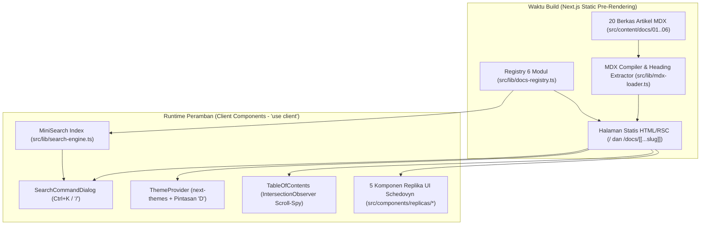

# Technical Design Document (TDD): Schedovyn User Guide & Documentation Portal

| Informasi Dokumen | Detail |
|---|---|
| **Nama Proyek** | Schedovyn User Guide (Portal Panduan Pemakaian & Dokumentasi Resmi) |
| **Produk Induk** | Schedovyn (*Smart Timetable Planner*) |
| **Versi Dokumen** | 1.0.0 |
| **Status** | Dokumen Rancangan Teknis Acuan (*Single Source of Truth* Teknis) |
| **Dokumen Terkait** | [Schedovyn-User-Guide-PRD.md](./Schedovyn-User-Guide-PRD.md), [DESIGN.md](../DESIGN.md), [AGENTS.md](../AGENTS.md) |
| **Runtime & Framework** | **Bun** (`^1.4.0`) + **Next.js** (`^16.4.3` App Router, RSC, Static Pre-rendering) + **React 19** + **TypeScript** (`strict: true`) |
| **Gaya Desain** | `radix-lyra` (*Architectural Technical Grid*, `rounded-none`, garis batas `1px`, Indigo-Blue `#1547E6`, `tabular-nums`) |

---

## 1. Ringkasan Arsitektur & Prinsip Teknis

### 1.1 Ikhtisar Arsitektur Sistem
**Schedovyn User Guide** dibangun sebagai aplikasi web dokumentasi statis (*Static Pre-rendered Documentation Portal*) berbasis **Next.js App Router**. Seluruh artikel panduan ditulis dalam format **MDX** di dalam repositori (`src/content/docs/`), dikompilasi pada waktu *build* menggunakan *React Server Components (RSC)*, dan diperkaya dengan pulau-pulau interaktivitas sisi klien (*Client Components* `"use client"`) untuk pencarian cepat `Ctrl+K`, penjelajah kamus konflik, sakelar pintasan keyboard, dan replika visual komponen Schedovyn.



### 1.2 Prinsip Rekayasa Utama
1. **100% Static Pre-Rendering (`NFR-UG-02`, `AC-UG-01`):**
   - Rute dinamis `/docs/[[...slug]]` menggunakan `generateStaticParams()` yang diturunkan langsung dari `getAllDocArticles()` pada `src/lib/docs-registry.ts`.
   - Tidak memerlukan server database atau pemanggilan API eksternal saat runtime; perpindahan halaman melalui `<Link>` Next.js berlangsung instan (`< 50 ms`).
2. **Pemisahan Tegas Server vs Client Components:**
   - **Server Components (Default):** `src/app/layout.tsx`, `src/app/page.tsx`, `src/app/docs/layout.tsx`, `src/app/docs/[[...slug]]/page.tsx`, `Callout.tsx`, `StepList.tsx`, dan `DocsPager.tsx`.
   - **Client Components (`"use client"`):** Hanya digunakan pada komponen yang membutuhkan *state*, *browser event listener*, atau DOM observer: `ThemeProvider.tsx`, `DocsNavbar.tsx`, `DocsSidebar.tsx`, `TableOfContents.tsx`, `SearchCommandDialog.tsx`, serta ke-5 komponen di `src/components/replicas/`.
3. **Zero `any` Policy & Strict TypeScript:**
   - Seluruh kontrak data modul, frontmatter MDX, indeks pencarian, kamus konflik, dan *props* komponen wajib didefinisikan dengan tipe TypeScript eksplisit (`strict: true`).
4. **Kepatuhan Bahasa & Bebas Karakter *Em Dash* (`NFR-UG-01`, `AC-UG-05`):**
   - Seluruh teks antarmuka, artikel MDX, dan label di dalam komponen replika wajib menggunakan Bahasa Indonesia yang 100% selaras dengan aplikasi utama Schedovyn dan **bebas dari karakter *em dash***.

### 1.3 Konfigurasi URL Lintas Proyek (`src/lib/env.ts`)
Portal panduan terhubung dengan aplikasi utama Schedovyn dan halaman Landing Page melalui konfigurasi lingkungan publik (`AC-UG-06`):

```ts
export interface PublicEnvConfig {
  readonly APP_URL: string;
  readonly LANDING_URL: string;
}

export const PUBLIC_ENV: PublicEnvConfig = {
  APP_URL: process.env.NEXT_PUBLIC_APP_URL || "https://app.schedovyn.com",
  LANDING_URL: process.env.NEXT_PUBLIC_LANDING_URL || "https://schedovyn.com",
};
```

---

## 2. Kontrak Data & Registry Navigasi 6 Modul (`src/lib/docs-registry.ts`)

### 2.1 Struktur Tipe Registry
`src/lib/docs-registry.ts` berfungsi sebagai sumber kebenaran tunggal (*Single Source of Truth*) untuk struktur navigasi 6 modul, pembuatan parameter rute statis, dan penentuan urutan halaman (*Artikel Sebelumnya / Selanjutnya*).

```ts
export type ModuleNumber = "01" | "02" | "03" | "04" | "05" | "06";

export interface DocArticleMeta {
  readonly order: string;          // Contoh: "1.1", "4.2" (tabular-nums)
  readonly title: string;          // Judul artikel Bahasa Indonesia (bebas em dash)
  readonly description: string;    // Ringkasan untuk SEO, kartu beranda, dan pencarian
  readonly moduleNumber: ModuleNumber;
  readonly moduleSlug: string;     // Contoh: "01-pengenalan"
  readonly moduleTitle: string;    // Contoh: "Pengenalan & Mulai Cepat"
  readonly articleSlug: string;    // Contoh: "mengenal-schedovyn"
  readonly href: string;           // Contoh: "/docs/01-pengenalan/mengenal-schedovyn"
  readonly filePath: string;       // Contoh: "01-pengenalan/mengenal-schedovyn.mdx"
}

export interface DocModuleGroup {
  readonly moduleNumber: ModuleNumber;
  readonly moduleSlug: string;
  readonly title: string;
  readonly description: string;
  readonly articles: readonly DocArticleMeta[];
}

export interface AdjacentArticles {
  readonly prev: DocArticleMeta | null;
  readonly next: DocArticleMeta | null;
}
```

### 2.2 Tabel Pemetaan 6 Modul & 20 Rute Artikel MDX
Seluruh 20 artikel wajib terdaftar secara berurutan di dalam `DOCS_MODULES`:

| Urutan | Modul | Path Berkas MDX (`src/content/docs/...`) | URL Rute (`/docs/...`) | Komponen Replika Tersemat |
|---|---|---|---|---|
| `1.1` | Modul 01 | `01-pengenalan/mengenal-schedovyn.mdx` | `/docs/01-pengenalan/mengenal-schedovyn` | `ValidationStatusBadgesReplica` |
| `1.2` | Modul 01 | `01-pengenalan/mulai-cepat-10-menit.mdx` | `/docs/01-pengenalan/mulai-cepat-10-menit` | `<StepList>` (5 Langkah) |
| `1.3` | Modul 01 | `01-pengenalan/tata-letak-aplikasi.mdx` | `/docs/01-pengenalan/tata-letak-aplikasi` | `SaveStatusBadgeReplica` |
| `2.1` | Modul 02 | `02-ruang-kerja-dan-data-master/pengaturan-jam-belajar.mdx` | `/docs/02-ruang-kerja-dan-data-master/pengaturan-jam-belajar` | `<StepList>`, `<Callout>` |
| `2.2` | Modul 02 | `02-ruang-kerja-dan-data-master/kelola-kelas-mapel-guru-ruangan.mdx` | `/docs/02-ruang-kerja-dan-data-master/kelola-kelas-mapel-guru-ruangan` | Tabel 10 Warna Mapel |
| `2.3` | Modul 02 | `02-ruang-kerja-dan-data-master/kebutuhan-pembelajaran-mingguan.mdx` | `/docs/02-ruang-kerja-dan-data-master/kebutuhan-pembelajaran-mingguan` | `<StepList>`, `<Callout>` |
| `3.1` | Modul 03 | `03-menyusun-jadwal-editor/memilih-kelas-aktif.mdx` | `/docs/03-menyusun-jadwal-editor/memilih-kelas-aktif` | `<Callout>` |
| `3.2` | Modul 03 | `03-menyusun-jadwal-editor/menempatkan-sesi-belum-terjadwal.mdx` | `/docs/03-menyusun-jadwal-editor/menempatkan-sesi-belum-terjadwal` | `<StepList>` |
| `3.3` | Modul 03 | `03-menyusun-jadwal-editor/menyunting-dan-memindahkan-sesi.mdx` | `/docs/03-menyusun-jadwal-editor/menyunting-dan-memindahkan-sesi` | `SessionBlockOverlapReplica` |
| `3.4` | Modul 03 | `03-menyusun-jadwal-editor/riwayat-undo-dan-redo.mdx` | `/docs/03-menyusun-jadwal-editor/riwayat-undo-dan-redo` | `<Callout>` |
| `3.5` | Modul 03 | `03-menyusun-jadwal-editor/menyalin-jadwal-antar-kelas.mdx` | `/docs/03-menyusun-jadwal-editor/menyalin-jadwal-antar-kelas` | `<StepList>`, Tabel Strategi Salin |
| `4.1` | Modul 04 | `04-kamus-konflik-dan-validasi/empat-status-validasi.mdx` | `/docs/04-kamus-konflik-dan-validasi/empat-status-validasi` | `ValidationStatusBadgesReplica` |
| `4.2` | Modul 04 | `04-kamus-konflik-dan-validasi/kamus-tujuh-konflik-waktu.mdx` | `/docs/04-kamus-konflik-dan-validasi/kamus-tujuh-konflik-waktu` | `ConflictDictionaryExplorer` (Default: `ERROR`) |
| `4.3` | Modul 04 | `04-kamus-konflik-dan-validasi/kamus-lima-peringatan-kelengkapan.mdx` | `/docs/04-kamus-konflik-dan-validasi/kamus-lima-peringatan-kelengkapan` | `ConflictDictionaryExplorer` (Default: `WARNING`) |
| `4.4` | Modul 04 | `04-kamus-konflik-dan-validasi/matriks-kelengkapan-kelas.mdx` | `/docs/04-kamus-konflik-dan-validasi/matriks-kelengkapan-kelas` | `<StepList>` |
| `5.1` | Modul 05 | `05-ekspor-dokumen/ekspor-pdf-landscape.mdx` | `/docs/05-ekspor-dokumen/ekspor-pdf-landscape` | `<StepList>`, `<Callout>` |
| `5.2` | Modul 05 | `05-ekspor-dokumen/ekspor-excel-dan-rekap-guru.mdx` | `/docs/05-ekspor-dokumen/ekspor-excel-dan-rekap-guru` | Tabel 4 Worksheet Excel |
| `6.1` | Modul 06 | `06-penyimpanan-pwa-dan-pintasan/penyimpanan-otomatis-indexeddb.mdx` | `/docs/06-penyimpanan-pwa-dan-pintasan/penyimpanan-otomatis-indexeddb` | `SaveStatusBadgeReplica` |
| `6.2` | Modul 06 | `06-penyimpanan-pwa-dan-pintasan/pasang-aplikasi-pwa-offline.mdx` | `/docs/06-penyimpanan-pwa-dan-pintasan/pasang-aplikasi-pwa-offline` | `<StepList>` |
| `6.3` | Modul 06 | `06-penyimpanan-pwa-dan-pintasan/daftar-pintasan-keyboard.mdx` | `/docs/06-penyimpanan-pwa-dan-pintasan/daftar-pintasan-keyboard` | `KeyboardShortcutSwitch` |
| `6.4` | Modul 06 | `06-penyimpanan-pwa-dan-pintasan/studi-kasus-smp-nusantara.mdx` | `/docs/06-penyimpanan-pwa-dan-pintasan/studi-kasus-smp-nusantara` | `<StepList>`, `ValidationStatusBadgesReplica` |

### 2.3 Aturan Resolusi Rute Dinamis (`/docs/[[...slug]]/page.tsx`)
Dalam Next.js 16 App Router, `params` pada komponen halaman bersifat *asynchronous* (`Promise<{ slug?: string[] }>`):
1. **`generateStaticParams()`:**
   Mengembalikan:
   - `{ slug: undefined }` (untuk rute indeks `/docs`)
   - `{ slug: [moduleGroup.moduleSlug] }` (untuk rute level modul `/docs/01-pengenalan`, dll.)
   - `{ slug: [article.moduleSlug, article.articleSlug] }` (untuk ke-20 rute artikel penuh).
2. **Resolusi `getDocArticleBySlug(slug)`:**
   - Jika `slug` kosong (`/docs`), mengembalikan artikel pertama (`1.1 Mengenal Schedovyn & Prinsip Kerja`).
   - Jika `slug` berisi 1 segmen modul (`/docs/02-ruang-kerja-dan-data-master`), mengembalikan artikel pertama di dalam modul tersebut (`2.1`).
   - Jika `slug` berisi 2 segmen valid (`/docs/[moduleSlug]/[articleSlug]`), mengembalikan metadata artikel terkait.
   - Jika `slug` tidak cocok dengan artikel mana pun, memanggil `notFound()` dari `next/navigation`.

---

## 3. Arsitektur Pemuatan MDX & Ekstraksi Daftar Isi (`src/lib/mdx-loader.ts`)

### 3.1 Kontrak Pemuat Artikel MDX (`src/lib/mdx-loader.ts`)
Pemuat MDX membaca berkas dari `src/content/docs/` pada sisi server, mengekstrak sub-judul `H2` dan `H3` untuk `TableOfContents`, serta mengompilasi MDX menjadi elemen React menggunakan `compileMDX` dari `next-mdx-remote/rsc` dengan plugin `remark-gfm`.

```ts
import type { ReactNode } from "react";
import type { DocArticleMeta } from "./docs-registry";

export interface TocHeadingItem {
  readonly id: string;
  readonly text: string;
  readonly level: 2 | 3;
}

export interface CompiledDocPage {
  readonly meta: DocArticleMeta;
  readonly content: ReactNode;
  readonly headings: readonly TocHeadingItem[];
  readonly rawBody: string;
}
```

### 3.2 Algoritma Slugifikasi Heading & Sinkronisasi TOC
Agar tautan jangkar (`#id`) pada `TableOfContents.tsx` selalu cocok dengan elemen `<h2>` dan `<h3>` yang dirender di dalam artikel MDX:
1. Buat fungsi murni `slugifyHeading(text: string): string`:
   ```ts
   export function slugifyHeading(text: string): string {
     return text
       .toLowerCase()
       .replace(/[`*_~()[\]{}:;,.!?/\\+]+/g, "")
       .trim()
       .replace(/\s+/g, "-");
   }
   ```
2. Fungsi `extractHeadingsFromMdx(rawMdx: string): readonly TocHeadingItem[]` memindai baris yang diawali `## ` (level `2`) dan `### ` (level `3`) di luar blok kode berpagar (` ``` `), lalu menghasilkan daftar `{ id, text, level }`.
3. Komponen pengganti MDX untuk `h2` dan `h3` secara otomatis menghitung `id={slugifyHeading(extractTextFromChildren(children))}` dan memasang kelas `scroll-mt-20` agar judul tidak tertutup oleh `DocsNavbar` (`h-14`) saat diklik dari daftar isi.

### 3.3 Peta Komponen Kustom MDX (`mdxComponents`)
Setiap berkas `.mdx` dapat langsung menggunakan komponen berikut tanpa perlu melakukan `import` manual di dalam berkas `.mdx`:
- Tipografi & Tabel Standar: `h1`, `h2`, `h3`, `p`, `ul`, `ol`, `li`, `table`, `thead`, `tbody`, `tr`, `th`, `td`, `code`, `pre`, `kbd`, `blockquote`, `a`.
- Komponen Struktur Dokumentasi:
  - `<Callout variant="info" | "tip" | "warning" | "danger" title="...">`
  - `<StepList>` dan `<StepItem step={1} title="...">`
- Komponen Replika UI Interaktif:
  - `<ValidationStatusBadgesReplica />`
  - `<ConflictDictionaryExplorer initialFilter="ALL" | "ERROR" | "WARNING" />`
  - `<SaveStatusBadgeReplica />`
  - `<SessionBlockOverlapReplica />`
  - `<KeyboardShortcutSwitch />`

---

## 4. Mesin Pencarian Instan Client-Side (`src/lib/search-engine.ts` & `SearchCommandDialog.tsx`)

### 4.1 Arsitektur Pengindeksan (`MiniSearch`)
Pencarian bekerja 100% di sisi klien (`FR-UG-02`, `AC-UG-03`) menggunakan pustaka `MiniSearch`:
- **Field yang Diindeks & Bobot (*Boost*):**
  - `keywordsText` (bobot `4.0`): Mencakup kode sistem (`TEACHER_OVERLAP`, `COMPLETE_AND_VALID`, dll.), nama tombol (`Tempatkan ke Jadwal`, `Salin Jadwal`, `Batal Perubahan`), serta sinonim kendala pengguna (`istirahat`, `konflik guru`, `excel`, `undo`).
  - `articleTitle` (bobot `3.0`): Judul artikel panduan.
  - `sectionHeading` (bobot `2.5`): Nomor bab + judul sub-bagian.
  - `content` (bobot `1.5`): Ringkasan dan isi materi panduan.
  - `moduleTitle` (bobot `1.0`): Nama modul.
- **Opsi Pencarian:**
  - `prefix: true` (mengetik `"konf"` langsung menemukan `"konflik"`).
  - `fuzzy: 0.2` (toleransi salah ketik ringan).
- **Pengelompokan Hasil (`searchDocsGroupedByModule`):**
  - Mengelompokkan hasil pencarian berdasarkan `moduleNumber` (`01` s.d. `06`) beserta cuplikan kalimat (`excerpt` sepanjang maksimal 160 karakter di sekitar kata kunci yang cocok).

### 4.2 Kontrak Perilaku `SearchCommandDialog.tsx` (`"use client"`)
- **Pemicu Buka/Tutup:**
  - Mendengarkan *keyboard shortcut* global `Ctrl+K`, `Cmd+K`, atau `/` (ketika fokus tidak berada di dalam `<input>` / `<textarea>`).
  - Dapat dibuka melalui klik tombol pencarian pada `DocsNavbar` maupun tombol pencarian cepat di halaman Beranda (`/`).
  - Dapat ditutup dengan menekan `Escape` atau mengeklik area *backdrop*.
- **State & Navigasi:**
  - Saat dialog terbuka, fokus otomatis diarahkan ke kolom input pencarian.
  - Jika input masih kosong, menampilkan **Akses Cepat 6 Modul** dan **Kata Kunci Populer** (`"istirahat"`, `"konflik guru"`, `"salin jadwal"`, `"excel"`, `"undo"`).
  - Jika kata kunci menghasilkan kecocokan, menampilkan daftar per modul; menekan `Enter` atau mengeklik salah satu hasil akan memanggil `router.push(item.href)` dan menutup dialog.
  - **Empty State Jujur (`R-27`):** Jika kata kunci tidak menghasilkan kecocokan, menampilkan pesan informatif dalam Bahasa Indonesia beserta tombol pintas menuju halaman **Kamus Konflik & Validasi**.

---

## 5. Spesifikasi Komponen Kerangka Dokumentasi (`src/components/docs/`)

### 5.1 `DocsNavbar.tsx` (`"use client"`)
- **Geometri:** `sticky top-0 z-40 h-14 w-full border-b border-[var(--border)] bg-[var(--background)]/90 backdrop-blur-md no-print`.
- **Elemen Kiri:**
  - Tombol hamburger menu khusus layar `< 1024px` (`lg:hidden`, target sentuh minimal `44x44px`) untuk membuka *drawer* `DocsSidebar`.
  - Brand Link menuju `/`: Ikon kotak teknis Schedovyn + teks **"Schedovyn"** (`font-heading font-bold`) + lencana teks **"PANDUAN"** (`border border-[var(--border)] px-1.5 py-0.5 text-[11px] font-mono`).
  - Tautan navigasi menuju **Beranda Panduan** (`/`) dan **Halaman Utama Produk** (`PUBLIC_ENV.LANDING_URL`).
- **Elemen Kanan:**
  - Tombol Pemicu Pencarian (`h-8`, `border border-[var(--border)]`, `bg-[var(--surface-subtle)]`) bertuliskan `"Cari panduan atau kode konflik..."` dengan indikator `<kbd>Ctrl K</kbd>`.
  - Tombol Pengubah Tema Terang/Gelap (`h-8 w-8`, `title="Ganti tema tampilan (Pintasan: D)"`).
  - Tombol CTA Utama **"Buka Aplikasi Schedovyn"** (`href={PUBLIC_ENV.APP_URL}`, warna latar `bg-[var(--primary)] text-[var(--primary-foreground)] h-8 px-3 text-xs font-medium`) dengan ikon `ArrowUpRight` (`AC-UG-06`).

### 5.2 `DocsSidebar.tsx` (`"use client"`)
- **Props:**
  ```ts
  export interface DocsSidebarProps {
    readonly modules?: readonly DocModuleGroup[];
    readonly mobileOpen?: boolean;
    readonly onMobileClose?: () => void;
  }
  ```
- **Perilaku:**
  - Membaca rute aktif menggunakan `usePathname()` dari `next/navigation` (jika berada di `/docs`, menyorot artikel `1.1`).
  - Merender ke-6 grup modul (`01` s.d. `06` dengan `tabular-nums`) dan daftar sub-artikelnya.
  - Item yang sedang aktif diberi kelas `border-l-2 border-[var(--primary)] bg-[var(--surface-subtle)] font-semibold text-[var(--primary)]` dan atribut `aria-current="page"`.
  - Pada layar *mobile* (`< 1024px`), dirender di dalam panel `Dialog` samping (*drawer*) yang menutup otomatis saat salah satu tautan artikel diklik atau tombol `Escape` ditekan.

### 5.3 `TableOfContents.tsx` (`"use client"`)
- **Props:**
  ```ts
  export interface TableOfContentsProps {
    readonly headings: readonly TocHeadingItem[];
  }
  ```
- **Perilaku:**
  - Ditampilkan pada kolom kanan desktop (`hidden xl:block w-56 shrink-0`).
  - Menggunakan `IntersectionObserver` untuk memantau elemen `h2[id]` dan `h3[id]` di dalam area artikel dan menyorot sub-judul yang sedang terlihat di *viewport*.
  - Jika `headings.length === 0`, menampilkan informasi singkat bahwa halaman tidak memiliki sub-bagian tambahan.

### 5.4 `DocsPager.tsx` (Server Component)
- **Props:**
  ```ts
  export interface DocsPagerProps {
    readonly currentHref: string;
  }
  ```
- **Perilaku:**
  - Memanggil `getAdjacentArticles(currentHref)`.
  - Menampilkan dua kartu tautan berbatas `1px solid var(--border)` (`grid-cols-1 sm:grid-cols-2 gap-4 mt-12 pt-6 border-t border-[var(--border)] no-print`):
    - Kiri: Label `"Artikel Sebelumnya"` beserta nomor urut (`prev.order`) dan judul `prev.title`.
    - Kanan: Label `"Artikel Selanjutnya"` beserta nomor urut (`next.order`) dan judul `next.title`.

### 5.5 `Callout.tsx` & `StepList.tsx` (Server Components)
- **`Callout.tsx`:**
  - Mendukung `variant: "info" | "tip" | "warning" | "danger"` dan `title: string`.
  - Menggunakan token warna semantik dari `src/app/globals.css` (`--status-info-*`, `--status-valid-*`, `--status-warning-*`, `--status-error-*`), sudut tajam `rounded-none`, bingkai `1px solid`, dan `break-inside-avoid` untuk mode cetak.
- **`StepList.tsx`:**
  - Terdiri atas `<StepList>` dan `<StepItem step={number} title={string}>`.
  - Menampilkan nomor langkah di dalam kotak persegi `28x28px` (`border border-[var(--primary)] bg-[var(--surface-subtle)] text-[var(--primary)] font-mono text-xs font-bold tabular-nums`) dengan garis penghubung vertikal `1px solid var(--border)`.

---

## 6. Spesifikasi Teknis & Kontrak Data 5 Komponen Replika UI (`src/components/replicas/`)

Seluruh komponen replika wajib menggunakan direktif `"use client"`, dibungkus dalam bingkai peraga teknis berlabel `"PERAGA INTERAKTIF ANTARMUKA SCHEDOVYN"`, dan memuat terminologi Bahasa Indonesia yang 100% akurat sesuai `AC-UG-04` dan `AC-UG-05`.

### 6.1 `ValidationStatusBadgesReplica.tsx`
Mendokumentasikan dan menyimulasikan **4 Status Validasi Jadwal** resmi Schedovyn:

| Kode Sistem (`code`) | Label UI Resmi (`label`) | Varian Warna | Kondisi Kelas Aktif | Kondisi Seluruh Ruang Kerja |
|---|---|---|---|---|
| `CONFLICT_DETECTED` | `"Konflik ditemukan"` | `error` (Merah) | Terdapat >= 1 bentrokan waktu nyata | Terdapat >= 1 bentrokan waktu di ruang kerja |
| `INCOMPLETE` | `"Belum lengkap"` | `warning` (Kuning) | 0 bentrokan waktu, namun masih ada sesi belum terjadwal / peringatan kelengkapan | Belum seluruh kebutuhan sesi terpenuhi |
| `NO_CONFLICT_CURRENT_DATA` | `"Tidak ada konflik pada data saat ini"` | `info` (Biru) | Kelas aktif 100% lengkap dan 0 konflik | Kelas lain di sekolah masih belum selesai disusun |
| `COMPLETE_AND_VALID` | `"Jadwal lengkap dan valid"` | `valid` (Hijau) | Kelas aktif 100% lengkap dan 0 konflik | Seluruh kelas di sekolah 100% lengkap dan 0 konflik |

- **Interaksi:** Pengguna dapat mengeklik salah satu dari ke-4 lencana status untuk melihat rincian kode sistem, penjelasan kondisi di lapangan, contoh kasus di `SMP Negeri 1 Nusantara`, dan langkah tindakan yang harus dilakukan.

### 6.2 `ConflictDictionaryExplorer.tsx`
Menyediakan kamus interaktif dengan pemfilteran kategori (`ALL`, `ERROR`, `WARNING`) dan pencarian instan (`FR-UG-04`, `AC-UG-04`) untuk **12 Kode Validasi Schedovyn**:

#### A. 7 Jenis Bentrokan Waktu (Kategori: `ERROR` / Merah)
1. `CLASS_OVERLAP`: **Jadwal Kelas Tumpang Tindih** (Dua atau lebih sesi ditempatkan pada hari dan rentang jam yang beririsan di kelas yang sama).
2. `TEACHER_OVERLAP`: **Bentrokan Jadwal Guru** (Satu guru dijadwalkan mengajar di dua atau lebih kelas berbeda pada hari dan jam yang beririsan).
3. `ROOM_OVERLAP`: **Bentrokan Pemakaian Ruangan** (Satu ruangan yang sama dipakai oleh dua atau lebih kelas pada hari dan jam yang beririsan).
4. `TEACHER_UNAVAILABLE`: **Guru Tidak Bersedia** (Sesi dijadwalkan pada rentang waktu ketika guru pengajar tercatat tidak hadir di menu Data Master Guru).
5. `ROOM_UNAVAILABLE`: **Ruangan Tidak Tersedia** (Sesi dijadwalkan pada rentang waktu ketika ruangan sedang tidak dapat dipakai).
6. `OUTSIDE_OPERATING_HOURS`: **Sesi di Luar Jam Belajar** (Jam mulai atau jam selesai sesi melewati batas jam operasional hari sekolah terkait, misalnya hari Jumat yang pulang lebih awal).
7. `BREAK_TIME_OVERLAP`: **Sesi Beririsan dengan Waktu Istirahat** (Rentang waktu sesi memotong jam istirahat sekolah pada hari tersebut).

#### B. 5 Peringatan Kelengkapan (Kategori: `WARNING` / Kuning)
1. `UNFULFILLED_REQUIREMENT`: **Alokasi Sesi Belum Lengkap** (Jumlah sesi yang ditempatkan ke grid masih kurang dari target `sessionsPerWeek` pada Kebutuhan Pembelajaran Mingguan).
2. `OVER_SCHEDULED_SESSION`: **Alokasi Sesi Melebihi Kebutuhan** (Jumlah sesi pada grid melebihi target mingguan yang ditetapkan).
3. `MISSING_TEACHER`: **Guru Belum Ditentukan** (Sesi atau kebutuhan pembelajaran belum memiliki guru pengajar).
4. `MISSING_REQUIRED_ROOM`: **Ruangan Khusus Belum Dipilih** (Mata pelajaran mewajibkan ruangan khusus `roomRequired: true`, tetapi ruangan belum ditentukan pada sesi tersebut).
5. `UNCONFIGURED_CLASS`: **Kelas Belum Dikonfigurasi** (Rombongan belajar sudah terdaftar di Data Master Kelas, namun belum memiliki daftar Kebutuhan Pembelajaran Mingguan sama sekali).

### 6.3 `SaveStatusBadgeReplica.tsx`
Menyimulasikan **3 Status Penyimpanan Otomatis Lokal (IndexedDB)** di bilah header Schedovyn (`AC-UG-05`):
1. `"Menyimpan..."`: Menampilkan indikator proses penyimpanan transaksi ke IndexedDB peramban.
2. `"Tersimpan di browser"`: Status aman. Ketika pengguna mengeklik lencana atau memilih mode ini, tampilkan replika *popover* detail yang memuat:
   - Waktu Simpan Terakhir: `10:42:18` (`tabular-nums`, format `HH:mm:ss`).
   - Lokasi Penyimpanan: `IndexedDB Lokal (schedovyn_local_db)`.
   - Estimasi Pemakaian Kuota Peramban: `1,4 MB dari 1.024 MB (0,1%)`.
3. `"Gagal menyimpan lokal"`: Status galat penyimpanan disertai penjelasan penyebab (`Ruang Penyimpanan Browser Penuh` atau `Akses Penyimpanan Dibatasi` pada mode penyamaran) dan langkah penyelamatan data melalui menu Ekspor Excel/PDF.

### 6.4 `SessionBlockOverlapReplica.tsx`
Menyimulasikan tampilan blok sesi pada kanvas grid waktu (`Modul 3.3`):
- Memiliki sakelar skenario:
  1. ** Kondisi Tumpang Tindih (*Overlap Cluster*):** Menampilkan dua blok sesi berdampingan pada kolom hari **Senin, 07:30 - 09:00** di **Kelas VII-A** (`Matematika` bersama `Budi Santoso, S.Pd.` dan `Ilmu Pengetahuan Alam (IPA)` bersama `Siti Aminah, M.Pd.`) lengkap dengan bingkai merah peringatan `CLASS_OVERLAP`.
  2. **Kondisi Terjadwal Berurutan (Bebas Konflik):** Menampilkan kedua sesi yang telah dipisahkan secara berurutan (`07:30 - 09:00` dan `09:00 - 10:30`, sesuai aturan batas waktu tepat `startA < endB && startB < endA`) atau setelah salah satu sesi dilepas kembali ke panel belum terjadwal menggunakan tombol **"Lepas dari Grid"** / **"Tempatkan ke Jadwal"**.

### 6.5 `KeyboardShortcutSwitch.tsx`
Menyediakan sakelar interaktif antara **`Windows / Linux`** dan **`macOS`** (`FR-UG-04`) untuk ke-7 pintasan keyboard resmi Schedovyn (`PRD Bab 4 Modul 6.3`):

| Aksi di Aplikasi Schedovyn | Tombol Windows / Linux | Tombol macOS | Keterangan Fungsi |
|---|---|---|---|
| **Batal Perubahan (*Undo*)** | `Ctrl + Z` | `Cmd + Z` | Membatalkan hingga 50 langkah penyuntingan terakhir |
| **Ulangi Perubahan (*Redo*)** | `Ctrl + Y` atau `Ctrl + Shift + Z` | `Cmd + Shift + Z` | Mengulangi langkah perubahan yang baru saja dibatalkan |
| **Geser Waktu Sesi Maju / Mundur** | `Alt + ArrowUp` / `Alt + ArrowDown` | `Option + ArrowUp` / `Option + ArrowDown` | Menggeser jam sesi yang dipilih sebesar interval snap (`15/30/45/60` menit) |
| **Pindahkan Sesi Antar-Hari** | `Alt + ArrowLeft` / `Alt + ArrowRight` | `Option + ArrowLeft` / `Option + ArrowRight` | Memindahkan sesi yang dipilih ke hari sekolah sebelumnya atau berikutnya |
| **Lepas dari Grid** | `Delete` / `Backspace` | `Delete` / `Backspace` | Melepas sesi yang dipilih kembali ke panel sesi belum terjadwal |
| **Fokus ke Panel Detail Sesi** | `Enter` | `Enter` | Membuka fokus langsung ke formulir penyuntingan pada Panel Detail Sesi |
| **Ganti Tema Tampilan** | `D` | `D` | Mengganti tema tampilan antara Mode Terang dan Mode Gelap |

---

## 7. Strategi Pengujian Berbasis TDD (`Vitest` & `@testing-library/react`)

Seluruh pengembangan fitur wajib mengikuti siklus **Red-Green-Refactor** yang didefinisikan pada `AGENTS.md`:

### 7.1 Matriks Cakupan Pengujian Otomatis (`src/__tests__/`)

| Berkas Pengujian | Target Modul / Komponen | Kriteria Penerimaan yang Diuji |
|---|---|---|
| `src/__tests__/foundation-setup.test.tsx` | `docs-registry.ts`, `search-engine.ts`, `ThemeProvider.tsx`, `env.ts` | `AC-UG-01`, `AC-UG-02`, `AC-UG-06`, `NFR-UG-01` (fondasi registry 6 modul, pencarian dasar, pintasan `D`, bebas *em dash*) |
| `src/__tests__/docs-layout-navigation.test.tsx` | `DocsNavbar.tsx`, `DocsSidebar.tsx`, `TableOfContents.tsx`, `DocsPager.tsx` | `FR-UG-01`, `AC-UG-02`, `AC-UG-06` (navigasi 6 modul tanpa *broken links*, penyorotan rute aktif, urutan *prev/next*, tombol `"Buka Aplikasi Schedovyn"`) |
| `src/__tests__/search-command-dialog.test.tsx` | `SearchCommandDialog.tsx`, `search-engine.ts` | `FR-UG-02`, `AC-UG-03` (pembukaan dialog lewat `Ctrl+K` atau `/`, hasil pencarian `"istirahat"`, `"konflik guru"`, `"excel"`, `"undo"`, navigasi rute saat diklik, dan *empty state*) |
| `src/__tests__/interactive-replicas.test.tsx` | `ValidationStatusBadgesReplica`, `ConflictDictionaryExplorer`, `SaveStatusBadgeReplica`, `SessionBlockOverlapReplica`, `KeyboardShortcutSwitch` | `FR-UG-03`, `FR-UG-04`, `AC-UG-04`, `AC-UG-05` (4 status validasi, filter 7 konflik waktu & 5 peringatan kelengkapan, 3 status simpan, tombol `"Lepas dari Grid"`, sakelar Windows/Linux vs macOS) |
| `src/__tests__/mdx-content-integrity.test.ts` | Seluruh 20 berkas `.mdx` di `src/content/docs/` & `mdx-loader.ts` | `FR-UG-05`, `NFR-UG-01`, `NFR-UG-02`, `AC-UG-01`, `AC-UG-05` (ketersediaan seluruh 20 berkas MDX, ketiadaan karakter *em dash* di seluruh artikel, kelengkapan studi kasus SMP Negeri 1 Nusantara, dan akurasi istilah UI) |

---

## 8. Peta Eksekusi Task (Implementation Roadmap)

Pengembangan dibagi ke dalam 4 tahap terstruktur di dalam `docs/tasks/`:

1. **`TASK-01` (Selesai): Instalasi & Setup Fondasi Proyek**
   - Instalasi paket Bun, token CSS `radix-lyra` & `@media print`, `ThemeProvider`, primitif `src/components/ui/`, kontrak `docs-registry.ts` & `search-engine.ts`, serta setup Vitest.
2. **`TASK-02`: Kerangka Tata Letak 3 Kolom, Navigasi, Pencarian `Ctrl+K`, & Halaman Beranda (`FR-UG-01`, `FR-UG-02`, `AC-UG-02`, `AC-UG-03`, `AC-UG-06`)**
   - Implementasi `src/lib/mdx-loader.ts`, `DocsNavbar.tsx`, `DocsSidebar.tsx`, `TableOfContents.tsx`, `DocsPager.tsx`, `Callout.tsx`, `StepList.tsx`, `SearchCommandDialog.tsx`, halaman Beranda `src/app/page.tsx`, serta rute `src/app/docs/layout.tsx` dan `src/app/docs/[[...slug]]/page.tsx`.
3. **`TASK-03`: Implementasi 5 Komponen Replika UI Interaktif (`FR-UG-03`, `FR-UG-04`, `AC-UG-04`, `AC-UG-05`)**
   - Implementasi `ValidationStatusBadgesReplica.tsx`, `ConflictDictionaryExplorer.tsx`, `SaveStatusBadgeReplica.tsx`, `SessionBlockOverlapReplica.tsx`, dan `KeyboardShortcutSwitch.tsx`.
4. **`TASK-04`: Penulisan 20 Artikel Panduan MDX pada 6 Modul & Studi Kasus Terpadu (`FR-UG-05`, `NFR-UG-01`, `AC-UG-01`, `AC-UG-05`)**
   - Penulisan lengkap seluruh 20 artikel MDX (`Modul 01` s.d. `Modul 06`) termasuk studi kasus `studi-kasus-smp-nusantara.mdx`, pengindeksan konten penuh ke `search-engine.ts`, dan pengujian integritas akhir (`bun run test` & `bun run build`).
